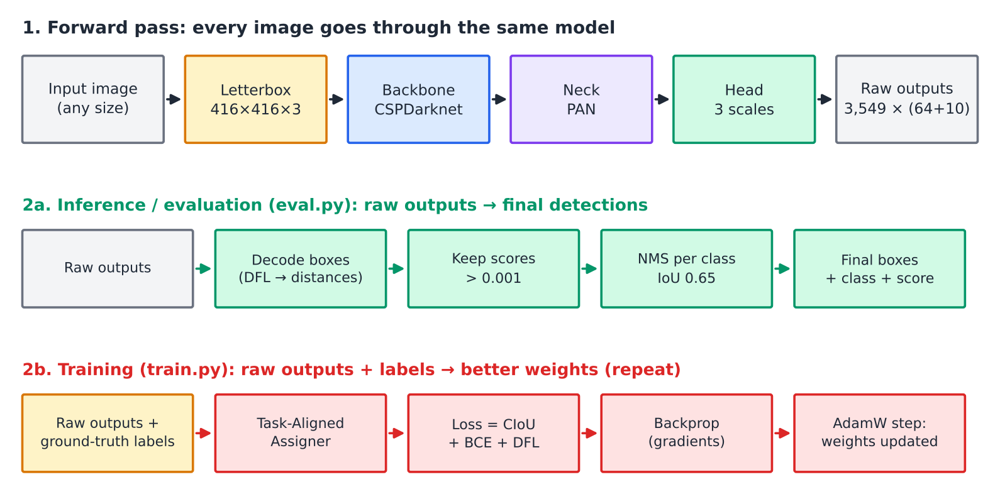
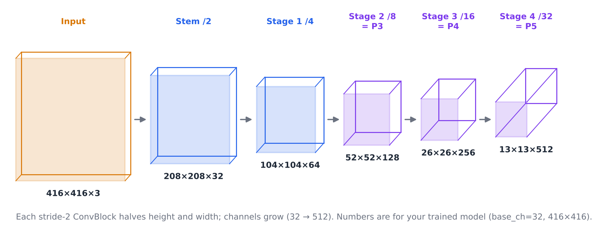
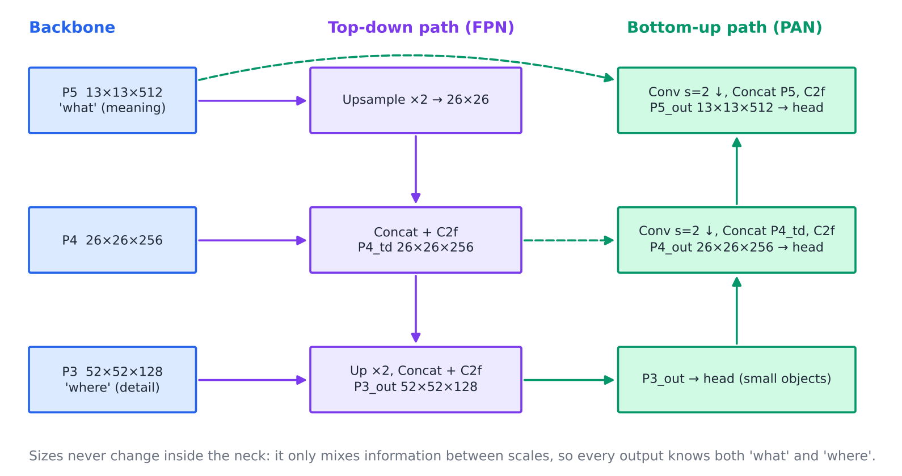
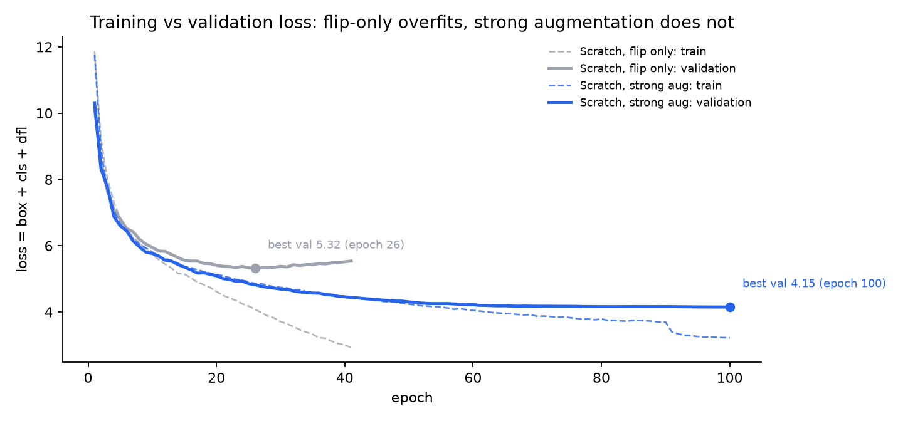
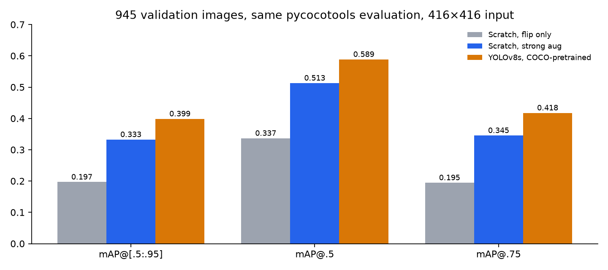
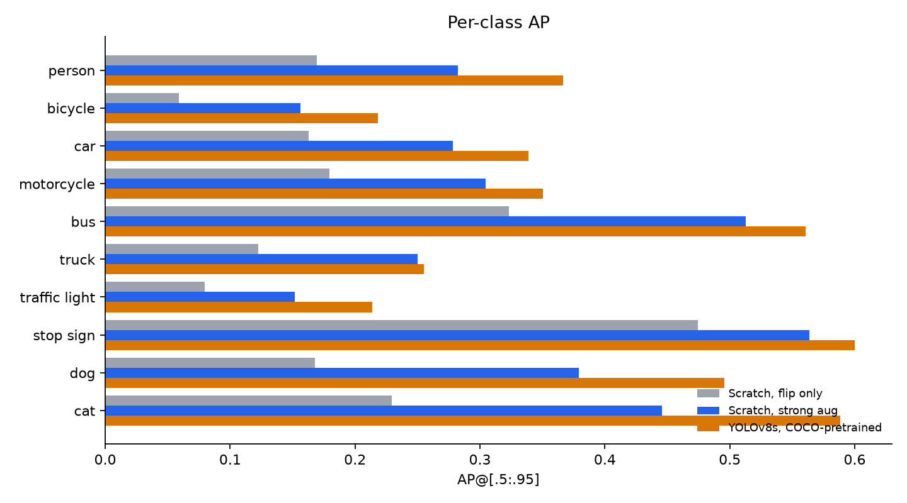

# YOLOv8 from Scratch

A YOLOv8-style object detector written from the ground up in PyTorch: backbone, neck, head, label assignment, loss, training loop and COCO evaluation. No detection library is used for the model or training. It is trained from random weights on a 10-class COCO subset and compared against a COCO-pretrained YOLOv8s trained and scored identically.

| | mAP@[.5:.95] | mAP@.5 | Recall (AR@100) |
|---|---|---|---|
| This model, from scratch, flip-only augmentation | 0.197 | 0.337 | 0.411 |
| **This model, from scratch, mosaic + scale + colour augmentation** | **0.333** | **0.513** | **0.514** |
| YOLOv8s (Ultralytics), COCO-pretrained, fine-tuned on the same data | 0.399 | 0.589 | 0.523 |

The from-scratch model reaches **83 % of the pretrained model's mAP** with the same size (11.1 M vs 11.2 M parameters), the same 6,000 training images and nearly the same recall.

---

## What is implemented



| Part | File | Details |
|---|---|---|
| Backbone | `models/backbone.py` | CSPDarknet: ConvBlock (Conv-BN-SiLU), Bottleneck, **C2f**, **SPPF**; outputs P3/P4/P5 at strides 8/16/32 |
| Neck | `models/neck.py` | **PAN**: top-down (upsample + concat) and bottom-up (stride-2 conv + concat) fusion |
| Head | `models/head.py` | **Decoupled, anchor-free** head; 4 × 16 **DFL** bins per box + one logit per class; prior-probability bias initialization |
| Model | `models/yolo.py` | backbone → neck → head; width `base_ch=32`, depth multiplier 0.33 → **11,105,150 parameters, 10.8 GFLOPs @ 416** |
| Assigner + loss | `utils/loss.py` | **Task-Aligned Assigner** (score^0.5 × IoU^6, top-10, IoU tie-break, soft targets); **CIoU** + **BCE** + **DFL**, gains 7.5 / 0.5 / 1.5 |
| Data | `data/download_coco_subset.py`, `data/dataset.py` | builds the subset from COCO annotations; letterbox, flip, YOLO-format labels |
| Augmentation | `data/augment.py` | **mosaic**, random scale (0.5–1.5×) and shift, HSV jitter; mosaic switched off for the last 10 epochs |
| Training | `train.py` | AdamW, 3-epoch warmup + cosine LR, **EMA** weights, gradient accumulation (8 × 4 = 32), gradient clipping, resume |
| Evaluation | `eval.py` | DFL decoding, per-class NMS, letterbox undo, **pycocotools** COCO mAP, per-class AP, sanity check (`--sanity-gt` → 1.000) |
| Comparison | `eval_ultra.py`, `coco10.yaml` | scores an Ultralytics model with exactly the same evaluation |

### How the tensor shapes change (416 × 416 input)



| Stage | Output | Stride |
|---|---|---|
| Input (letterboxed) | 416 × 416 × 3 | 1 |
| Stem | 208 × 208 × 32 | 2 |
| Stage 1 | 104 × 104 × 64 | 4 |
| Stage 2 → **P3** | 52 × 52 × 128 | 8 |
| Stage 3 → **P4** | 26 × 26 × 256 | 16 |
| Stage 4 + SPPF → **P5** | 13 × 13 × 512 | 32 |
| Head (per scale) | H × W × (64 box + 10 class) | 8 / 16 / 32 |

52² + 26² + 13² = **3,549 predictions per image**.



---

## Data

A balanced subset of COCO 2017 with 10 classes: person, bicycle, car, motorcycle, bus, truck, traffic light, stop sign, dog, cat.

| Split | Source | Images | Boxes |
|---|---|---|---|
| Train | COCO train2017 (≈ 600 images picked per class) | 6,000 | all boxes of the 10 classes in those images |
| Val | COCO val2017 | 945 | 6,247 |

Train and validation come from different COCO splits, so there is no overlap. Labels are converted from COCO `[x, y, w, h]` pixels to YOLO `class cx cy w h` (normalized 0–1).

---

## Results and what they show

### 1. The baseline overfitted; augmentation fixed it



With only horizontal flips, validation loss bottomed out at epoch 26 and then rose while training loss kept falling: the model was memorizing 6,000 images. Adding mosaic, random scale/shift and colour jitter (and nothing else: same model, image size and batch) closed the train/validation gap and raised mAP@[.5:.95] from **0.197 to 0.333** (AP small 0.032 → 0.077, AP large 0.324 → 0.504).

### 2. From scratch vs pretrained





| Class | From scratch | YOLOv8s pretrained | Gap |
|---|---|---|---|
| truck | 0.250 | 0.255 | 0.005 |
| stop sign | 0.564 | 0.600 | 0.036 |
| motorcycle | 0.304 | 0.350 | 0.046 |
| bus | 0.513 | 0.561 | 0.048 |
| car | 0.278 | 0.339 | 0.061 |
| bicycle | 0.156 | 0.218 | 0.062 |
| traffic light | 0.152 | 0.214 | 0.062 |
| person | 0.282 | 0.366 | 0.084 |
| dog | 0.379 | 0.496 | 0.117 |
| cat | 0.446 | 0.588 | 0.142 |

- Recall is almost the same (0.514 vs 0.523): the from-scratch model **finds** nearly as many objects. The gap is in box tightness and ranking (AP75 0.345 vs 0.418).
- The gap is largest for **cat and dog**, the classes with the fewest training examples, which is where pretraining on 118k images helps most, and nearly zero for truck.

### Honest notes

- Single training run per setting; differences in the third decimal are noise.
- `best.pt` is selected by validation loss on the same 945 images that are scored.
- Ultralytics' predictor uses rectangular letterboxing (slightly less padding) while this model uses square 416 × 416; the effect is small.
- These numbers are on a 10-class, 945-image subset and are **not** comparable to published full-COCO results.

---

## How to run

```bash
# environment (Python 3.12, CUDA GPU)
python3 -m venv venv && source venv/bin/activate
pip install torch torchvision --index-url https://download.pytorch.org/whl/cu128
pip install numpy opencv-python pycocotools pillow tqdm requests matplotlib ultralytics

# data: put COCO 2017 annotations in ~/projects/cv-portfolio/datasets/coco/annotations, then
python3 -m data.download_coco_subset          # builds datasets/coco_subset (6,000 train / 945 val)
python3 -m data.dataset                       # check: saves sample_check.jpg with boxes drawn
python3 -m data.augment                       # check: saves aug_check.jpg with 4 mosaics

# test each part
python3 models/backbone.py && python3 -m models.neck && python3 -m models.head
python3 -m models.yolo && python3 -m utils.loss

# train (≈ 1 hour on an RTX 3090) and evaluate
python3 train.py --aug strong --epochs 100 --workers 16 --out runs/exp2_aug
python3 eval.py --sanity-gt                   # must print AP 1.000
python3 eval.py --weights runs/exp2_aug/best.pt

# pretrained comparison
yolo detect train model=yolov8s.pt data=coco10.yaml imgsz=416 epochs=100 batch=32 project=runs/ultra name=v8s_pretrained
python3 eval_ultra.py --weights runs/detect/runs/ultra/v8s_pretrained/weights/best.pt

# README figures from your own logs
python3 make_figures.py
```

Dataset paths default to `~/projects/cv-portfolio/datasets/coco_subset`; pass `--data PATH` to `train.py` / `eval.py` to change it.

## Project structure

```
├── models/      backbone.py  neck.py  head.py  yolo.py
├── utils/       loss.py            (geometry, Task-Aligned Assigner, YOLOLoss)
├── data/        download_coco_subset.py  dataset.py  augment.py
├── train.py     eval.py     eval_ultra.py     coco10.yaml     make_figures.py
├── runs/        training logs (log.csv) and metrics (*.json); weights are not committed
└── assets/      figures used in this README
```

## Next steps

- Train at 640 × 640 (more pixels for small objects, currently the weakest area at AP 0.077).
- Longer schedule and stronger augmentation (mixup, copy-paste) for the from-scratch model.

## References

- Ultralytics YOLOv8 — architecture and training recipe this implementation follows.
- Feng et al., *TOOD: Task-aligned One-stage Object Detection*, ICCV 2021 — the task-aligned assigner.
- Li et al., *Generalized Focal Loss*, NeurIPS 2020 — Distribution Focal Loss.
- Zheng et al., *Distance-IoU Loss*, AAAI 2020 — CIoU.
- Liu et al., *Path Aggregation Network for Instance Segmentation*, CVPR 2018 — PAN.
- Lin et al., *Microsoft COCO: Common Objects in Context*, ECCV 2014.
